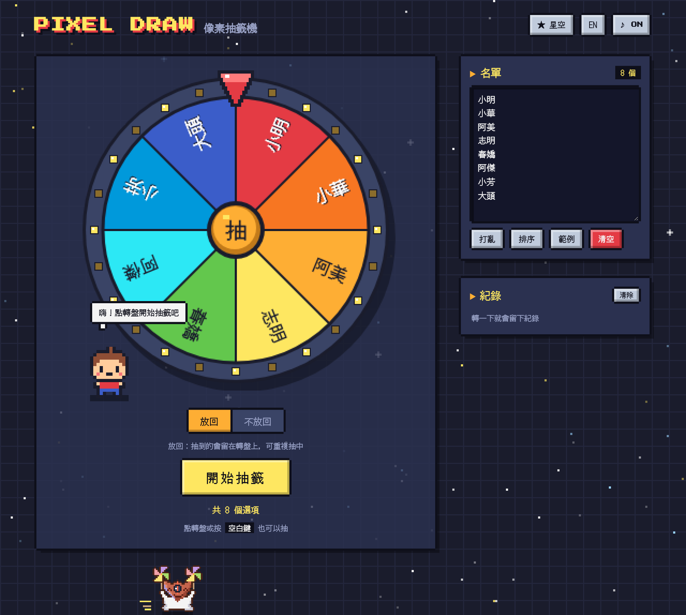

# 像素抽籤機 PIXEL DRAW

像素風的轉盤抽籤網頁，輸入名單、按下開始就能抽。

👉 線上使用：<https://dolphinhuang.github.io/pixel_draw/>



## 怎麼用

1. 在右邊「名單」輸入選項，一行一個
2. 選擇模式
   - **放回**：抽完的項目留在轉盤上，下次還可能抽到
   - **不放回**：抽中的項目會移除，直到全部抽完；可按「全部放回」重來
3. 按「開始抽籤」、點轉盤，或按空白鍵

右上角可以切換背景（星空 / 下雪 / 關閉）、中文 / English，以及開關音效。
名單和紀錄會自動存在瀏覽器裡。

## 小彩蛋

- 轉盤旁的像素小人會跟你說話，點它一下試試
- 底部有拿著風車跑步的小傢伙，可以抓起來甩

## 本機執行

```bash
python3 -m http.server 8000
```

然後打開 <http://localhost:8000>
